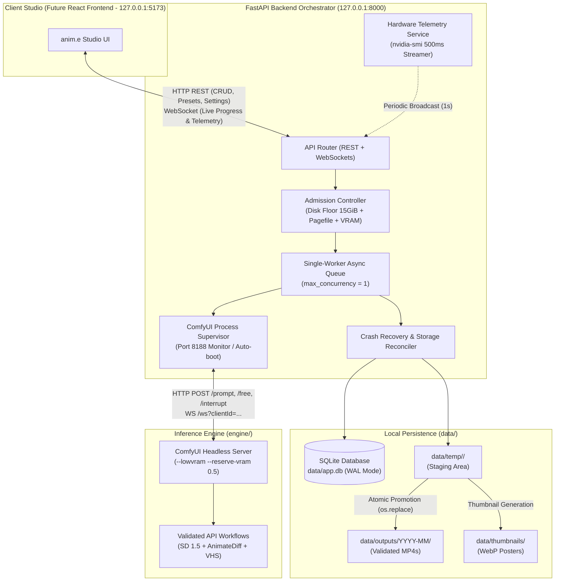
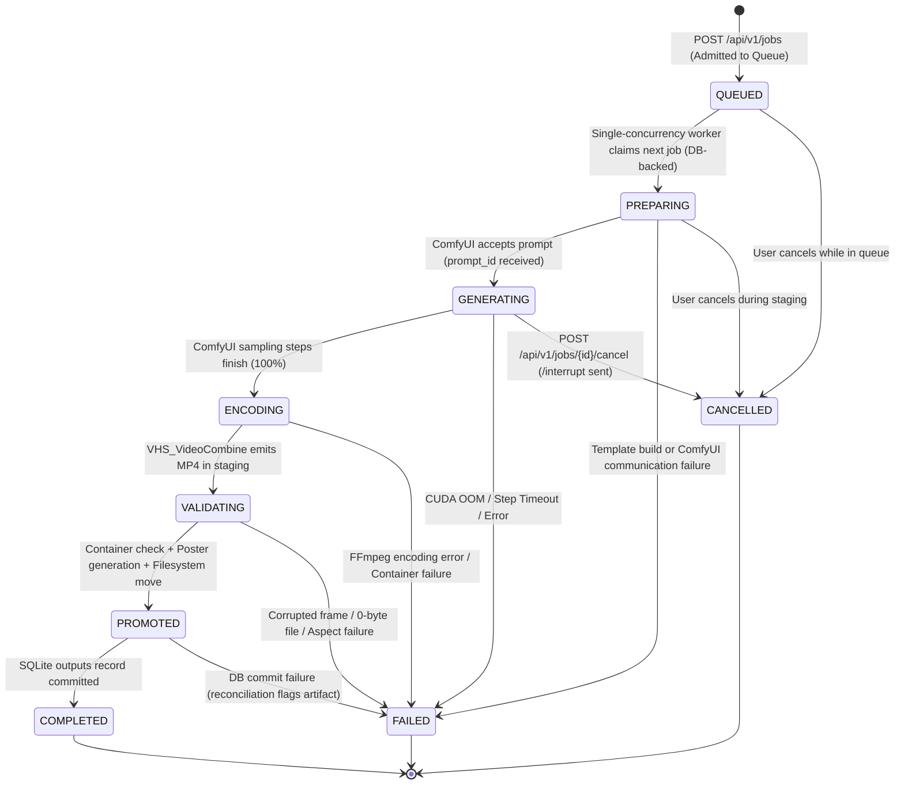

# anim.e Studio — Phase 2 Architecture & Implementation Blueprint

> **System Target:** Localhost Single-User Studio (`127.0.0.1`)  
> **Hardware Profile:** NVIDIA GeForce RTX 3050 Laptop GPU (4,096 MiB VRAM, 45W TGP), 16 GB RAM, Windows 11  
> **Backend Stack:** Python 3.12/3.13 + FastAPI + SQLite (WAL mode) + Uvicorn + WebSockets  
> **Engine Layer:** Headless ComfyUI Portable (CUDA 12.6, PyTorch 2.14.1, AnimateDiff v2, SD 1.5 Counterfeit-V3.0 FP16)  
> **Security Boundary:** Strict Loopback Binding (`127.0.0.1`), Zero Authentication, Zero Cloud/External Dependencies  

---

## 1. Verified Technical Baseline (Phase 1 Inheritance)

The Phase 2 architecture builds strictly upon the verified Phase 1 baseline recorded in `engine/manifest.json` and `data/outputs/poc/benchmark_results.json`:

```
+---------------------------------------------------------------------------------------------------------------+
| Verified Preset Mode | Resolution | Frames | Steps | Measured Duration | Peak VRAM  | Status / Visual Quality |
+---------------------------------------------------------------------------------------------------------------+
| 1. Fast Draft        | 384 × 384  | 8 (8 FPS) | 15  | 39.62s            | 3,151 MiB  | Passed (Stable, Smooth) |
| 2. Standard Loop     | 384 × 384  | 16 (8 FPS)| 16  | 58.59s            | 3,343 MiB  | Passed (Fluid, Coherent)|
| 3. High-Res Square   | 512 × 512  | 8 (8 FPS) | 16  | 56.58s            | 3,409 MiB  | Passed (Crisp Detail)   |
| 4. Portrait (Exp.)   | 384 × 512  | 8 (8 FPS) | 16  | 45.41s            | 3,313 MiB  | Passed (Boundary Pop)   |
+---------------------------------------------------------------------------------------------------------------+
```

- **Runtime Isolation:** The backend runs in a lightweight `.venv` (`requirements.txt` ~120 MB) with zero PyTorch duplication. All inference is orchestrated via HTTP/WebSocket to the isolated ComfyUI Portable engine (`127.0.0.1:8188`).
- **Telemetry Verification:** Real `nvidia-smi` measurements confirmed 0 MiB idle VRAM post-shutdown and peak memory remaining 687–945 MiB below the 4,096 MiB physical ceiling.

---

## 2. System Architecture & Component Design



### 2.1 Final Directory Layout (`Anim.e/`)

```text
Anim.e/
├── backend/
│   ├── app/
│   │   ├── __init__.py
│   │   ├── main.py                  # FastAPI app factory, lifespan startup/shutdown, CORS loopback
│   │   ├── core/
│   │   │   ├── config.py            # Pydantic Settings, paths, port 8000/8188, safety thresholds
│   │   │   ├── logging.py           # Structured JSON/Console logging with rotation
│   │   │   └── security.py          # Path traversal guards (safe_resolve_path)
│   │   ├── db/
│   │   │   ├── session.py           # SQLite connection pool, PRAGMA wal, foreign keys
│   │   │   ├── migrations.py        # Lightweight forward-only schema migration runner
│   │   │   └── repositories/        # Typed data access (JobRepo, OutputRepo, SettingRepo)
│   │   ├── schemas/                 # Pydantic v2 schemas for requests, responses, WebSocket events
│   │   │   ├── job.py
│   │   │   ├── output.py
│   │   │   ├── preset.py
│   │   │   └── telemetry.py
│   │   ├── services/
│   │   │   ├── admission.py         # 15 GiB disk guard + pagefile check + VRAM validator
│   │   │   ├── comfy_client.py      # HTTP/WebSocket client for ComfyUI API
│   │   │   ├── comfy_supervisor.py  # Health-check, auto-start, and graceful termination of ComfyUI
│   │   │   ├── queue_worker.py      # Single-worker asyncio queue, state transitions, timeout watchdog
│   │   │   ├── storage.py           # Two-phase file promotion, WebP thumbnail extraction, atomic unlinking
│   │   │   ├── telemetry.py         # Real-time nvidia-smi query and broadcast
│   │   │   └── recovery.py          # Startup reconciliation of dead/interrupted jobs & temp purge
│   │   ├── workflows/               # Pre-validated ComfyUI JSON templates
│   │   │   ├── txt2vid_draft_384.json
│   │   │   ├── txt2vid_loop_384.json
│   │   │   └── txt2vid_square_512.json
│   │   └── api/
│   │       ├── router.py            # Aggregated /api/v1 router
│   │       ├── endpoints/
│   │       │   ├── jobs.py          # Create, list, get, cancel endpoints
│   │       │   ├── outputs.py       # Stream MP4s, WebP thumbnails, download, delete
│   │       │   ├── presets.py       # Curated style presets & parameter bounds
│   │       │   ├── system.py        # Telemetry, disk status, manual cleanup, maintenance
│   │       │   └── ws.py            # WebSocket /ws/events for live progress & hardware stats
│   ├── tests/
│   │   ├── unit/                    # Path security, schema validation, admission controller tests
│   │   └── integration/             # SQLite transitions, ComfyUI mock/live queue, API contracts
│   ├── requirements.txt             # Pinned backend dependencies (no PyTorch!)
│   └── run_server.py                # Direct CLI entrypoint for Uvicorn
├── engine/                          # Pre-installed ComfyUI Portable (Untouched)
├── data/                            # Persistent state (app.db, outputs, thumbnails, logs)
└── docs/                            # Benchmarks & Architecture Blueprints
```

---

## 3. Job Lifecycle State Machine & Durable Persistence

To guarantee zero duplicate jobs, predictable concurrency, and crash resilience, the generation queue enforces a strict 6-stage finite state machine with SQLite as the authoritative source of truth. Multiple jobs may be queued concurrently, but exactly one job may actively utilize the GPU at any given time (`max_active_gpu = 1`).



### 3.1 State Definitions & Persistence Guarantees

| State | Allowed Transitions | Invariants & DB Commit Boundaries | Cleanup on Failure / Interrupt |
| :--- | :--- | :--- | :--- |
| **`QUEUED`** | `PREPARING`, `CANCELLED` | Job parameters and seed validated; persisted in SQLite `jobs` table with `status = 'queued'`. Arbitrary number of jobs may wait in this state. | Status updated to `CANCELLED` in DB. |
| **`PREPARING`** | `GENERATING`, `FAILED`, `CANCELLED` | Claimed by single worker; re-checks disk/pagefile admission; verifies ComfyUI availability; constructs API prompt. | Staging folder `data/temp/<job_id>/` wiped. |
| **`GENERATING`** | `ENCODING`, `FAILED`, `CANCELLED` | Active GPU execution; exactly one job running; WebSocket tracks step progress `1..N`; step watchdog monitors 90s stall limit. | Sends `/interrupt` to ComfyUI; calls `/free`; purges staging folder. |
| **`ENCODING`** | `VALIDATING`, `FAILED` | Diffusion latents passed to `VAEDecodeTiled` and `VHS_VideoCombine` (H.264 MP4). | Purges partial MP4 from `data/temp/<job_id>/`. |
| **`VALIDATING`** | `PROMOTED`, `FAILED` | OpenCV checks frame count, dimensions, non-black pixels; extracts WebP poster frame to staging. | Purges staging folder if validation fails. |
| **`PROMOTED`** | `COMPLETED`, `FAILED` | Filesystem move (`os.replace`) promotes files to `data/outputs/` and `data/thumbnails/`. If database commit fails, the startup reconciler discovers the uncommitted files and completes or rolls them back safely without data loss. | Reconciler checks disk against DB. |
| **`COMPLETED`** | *Terminal* | Both filesystem promotion and SQLite transaction succeed. Full metadata persisted. | Staging folder cleaned up. |
| **`FAILED`** | *Terminal* | Records error code, message, and peak VRAM. | Automatic purge of `data/temp/<job_id>/`. |
| **`CANCELLED`** | *Terminal* | User-initiated stop. ComfyUI `/interrupt` issued. | Automatic purge of `data/temp/<job_id>/`. |

---

## 4. Strict Resource Protection & Conservative Admission Control

The host system has **4,096 MiB VRAM**, **16 GB RAM**, and a strict **15.00 GiB minimum free disk floor**. During active diffusion, Windows 11 dynamically expands `C:\pagefile.sys` by up to **~9.5 GiB**.

Crucially, **we do not assume the pagefile is fully allocated simply because ComfyUI is running.** ComfyUI can idle without committing peak virtual memory; the dynamic expansion happens primarily when UNet latents, attention layers, and VAE weights stream between VRAM and system memory during an active job.

### 4.1 Conservative Admission Rule
To prevent any possibility of breaching the 15.00 GiB safety floor:
1. When evaluating a new generation request, the Admission Controller queries actual free disk space via `shutil.disk_usage("C:\\").free`.
2. It checks current Windows pagefile commit/usage. If current free space minus the maximum possible dynamic expansion (9.50 GiB) and output buffer (0.50 GiB) is less than 15.00 GiB, the job cannot be safely admitted:
   $$\text{Current Free Space} \ge 15.00\,\text{GiB} + 9.50\,\text{GiB} + 0.50\,\text{GiB} = 25.00\,\text{GiB}$$
3. If free space is below this threshold, the request is rejected with a structured HTTP 503 response explaining the exact disk deficit and advising the user to clean temporary files or free disk space.
4. Concurrency rule: Multiple jobs may be submitted and held in `queued` status, but the worker executes them strictly one at a time. The admission check is evaluated both at submission time (for immediate queue admission) and immediately before a job transitions from `queued` to `preparing`.

---

## 5. ComfyUI Process Lifecycle & Ownership Rules

To ensure reliable, non-destructive operation on Windows:
1. **Ownership Tracking:**
   - Before launching ComfyUI, the supervisor checks if `127.0.0.1:8188` is already responding to `/system_stats`.
   - If an instance is already running (e.g., launched manually by the user or an external script), the supervisor sets `is_owned = False` and connects as a client.
   - If no instance is listening, the supervisor launches ComfyUI Portable as a child process, records its PID in `data/.comfyui.pid`, and sets `is_owned = True`.
2. **Shutdown Rule:**
   - On application shutdown, the supervisor **never** terminates an externally managed ComfyUI process (`is_owned == False`).
   - If `is_owned == True`, the supervisor terminates the child process using Windows-compatible termination (`taskkill /PID ... /T /F` or `proc.terminate()`), removes `data/.comfyui.pid`, and polls `nvidia-smi` to verify VRAM returns to 0 MiB within 10 seconds.
3. **Safe Cancellation:**
   - Jobs are cancelled by posting to ComfyUI's `/interrupt` endpoint and `/free` endpoint. The process itself is not killed during normal job cancellation.

---

## 5. SQLite Database Schema & Migration Strategy

SQLite will run with WAL mode (`PRAGMA journal_mode = WAL;`), strict foreign key enforcement (`PRAGMA foreign_keys = ON;`), and busy timeouts (`PRAGMA busy_timeout = 5000;`).

### 5.1 Tables Definition (`data/app.db`)

```sql
-- Migration 001_initial_schema.sql

CREATE TABLE IF NOT EXISTS schema_versions (
    version INTEGER PRIMARY KEY,
    applied_at TEXT NOT NULL DEFAULT (datetime('now', 'utc'))
);

CREATE TABLE IF NOT EXISTS jobs (
    id TEXT PRIMARY KEY,                       -- UUIDv4
    prompt TEXT NOT NULL,
    negative_prompt TEXT NOT NULL,
    preset_id TEXT NOT NULL,                   -- e.g. 'fast_draft', 'standard_loop', 'high_res_square'
    resolution TEXT NOT NULL,                  -- '384x384', '512x512'
    width INTEGER NOT NULL,
    height INTEGER NOT NULL,
    frame_count INTEGER NOT NULL,
    fps INTEGER NOT NULL DEFAULT 8,
    steps INTEGER NOT NULL DEFAULT 16,
    cfg_scale REAL NOT NULL DEFAULT 7.0,
    sampler_name TEXT NOT NULL DEFAULT 'euler_ancestral',
    scheduler TEXT NOT NULL DEFAULT 'normal',
    seed INTEGER NOT NULL,
    status TEXT NOT NULL CHECK(status IN ('queued', 'preparing', 'generating', 'encoding', 'validating', 'completed', 'failed', 'cancelled')),
    progress_percent REAL NOT NULL DEFAULT 0.0,
    current_step INTEGER NOT NULL DEFAULT 0,
    total_steps INTEGER NOT NULL DEFAULT 16,
    comfy_prompt_id TEXT,
    error_code TEXT,
    error_message TEXT,
    created_at TEXT NOT NULL DEFAULT (datetime('now', 'utc')),
    started_at TEXT,
    completed_at TEXT,
    duration_sec REAL
);

CREATE INDEX IF NOT EXISTS idx_jobs_status_created ON jobs(status, created_at);

CREATE TABLE IF NOT EXISTS outputs (
    id TEXT PRIMARY KEY,                       -- UUIDv4
    job_id TEXT NOT NULL UNIQUE,
    video_path TEXT NOT NULL,                  -- Relative path: 'outputs/2026-11/job_<uuid>.mp4'
    thumbnail_path TEXT NOT NULL,              -- Relative path: 'thumbnails/job_<uuid>.webp'
    file_size_bytes INTEGER NOT NULL,
    width INTEGER NOT NULL,
    height INTEGER NOT NULL,
    frame_count INTEGER NOT NULL,
    fps REAL NOT NULL,
    duration_sec REAL NOT NULL,
    motion_score REAL,                         -- Computed inter-frame motion delta
    is_favorited INTEGER NOT NULL DEFAULT 0,
    created_at TEXT NOT NULL DEFAULT (datetime('now', 'utc')),
    FOREIGN KEY(job_id) REFERENCES jobs(id) ON DELETE CASCADE
);

CREATE INDEX IF NOT EXISTS idx_outputs_created ON outputs(created_at DESC);

CREATE TABLE IF NOT EXISTS hardware_telemetry (
    id INTEGER PRIMARY KEY AUTOINCREMENT,
    job_id TEXT NOT NULL,
    sample_time TEXT NOT NULL DEFAULT (datetime('now', 'utc')),
    vram_used_mib REAL NOT NULL,
    vram_total_mib REAL NOT NULL DEFAULT 4096.0,
    gpu_util_pct REAL NOT NULL,
    temp_c REAL NOT NULL,
    power_w REAL,
    FOREIGN KEY(job_id) REFERENCES jobs(id) ON DELETE CASCADE
);

CREATE INDEX IF NOT EXISTS idx_telemetry_job ON hardware_telemetry(job_id);

CREATE TABLE IF NOT EXISTS settings (
    key TEXT PRIMARY KEY,
    value_json TEXT NOT NULL,
    updated_at TEXT NOT NULL DEFAULT (datetime('now', 'utc'))
);

-- Seed initial settings
INSERT OR IGNORE INTO settings (key, value_json) VALUES 
('defaults', '{"preset": "standard_loop", "resolution": "384x384", "frames": 16, "fps": 8, "steps": 16, "cfg": 7.0}'),
('safety', '{"min_disk_free_gib": 15.0, "max_vram_limit_mib": 3600.0, "step_timeout_sec": 90.0}');
```

---

## 6. Comprehensive API Contracts (REST & WebSockets)

All endpoints bind strictly to `http://127.0.0.1:8000` under the `/api/v1` prefix.

### 6.1 Endpoints Summary

| Method | Endpoint | Description | Status Codes |
| :--- | :--- | :--- | :--- |
| `POST` | `/api/v1/jobs` | Submit new video generation job | `202 Accepted`, `400 Bad Request`, `503 Service Unavailable` (Safety Floor) |
| `GET` | `/api/v1/jobs` | List recent jobs with pagination and status filters | `200 OK` |
| `GET` | `/api/v1/jobs/{id}` | Get full job state, telemetry summary, and output metadata | `200 OK`, `404 Not Found` |
| `POST` | `/api/v1/jobs/{id}/cancel` | Cancel an in-flight or queued job | `200 OK`, `400 Bad Request`, `404 Not Found` |
| `GET` | `/api/v1/outputs` | List generated gallery items | `200 OK` |
| `GET` | `/api/v1/outputs/{id}/video` | Stream MP4 video with HTTP Range header support | `200 OK`, `206 Partial Content`, `404 Not Found` |
| `GET` | `/api/v1/outputs/{id}/poster` | Retrieve WebP poster image | `200 OK`, `404 Not Found` |
| `DELETE` | `/api/v1/outputs/{id}` | Atomic deletion of database record, MP4, and thumbnail | `204 No Content`, `404 Not Found` |
| `GET` | `/api/v1/presets` | Retrieve verified safe presets and parameter constraints | `200 OK` |
| `GET` | `/api/v1/system/status` | Read real-time GPU telemetry, disk space, and ComfyUI health | `200 OK` |
| `POST` | `/api/v1/system/cleanup` | Trigger purge of orphaned temp files and vacuum staging | `200 OK` |
| `WS` | `/api/v1/ws` | Bi-directional WebSocket for live progress, logs, and telemetry | `101 Switching Protocols` |

### 6.2 Sample Contract: `POST /api/v1/jobs`

**Request:**
```json
{
  "prompt": "1girl, silver hair, violet eyes, rooftop at twilight, cinematic lighting, Makoto Shinkai style, gentle breeze",
  "negative_prompt": "lowres, bad anatomy, bad hands, text, blurry, deformed",
  "preset_id": "standard_loop",
  "resolution": "384x384",
  "frame_count": 16,
  "fps": 8,
  "steps": 16,
  "cfg_scale": 7.0,
  "seed": 108080
}
```

**Response (`202 Accepted`):**
```json
{
  "job_id": "c7a82b9e-2d54-4672-9118-ffea91361280",
  "status": "queued",
  "queue_position": 1,
  "estimated_duration_sec": 58.0,
  "created_at": "2026-11-01T03:15:00Z"
}
```

**Failure Response (`503 Service Unavailable` — Disk Guard Triggered):**
```json
{
  "error_code": "DISK_SAFETY_FLOOR_EXCEEDED",
  "message": "Job rejected: Current free disk space is 22.40 GiB. To safely allow Windows pagefile expansion (+9.50 GiB) while guaranteeing the 15.00 GiB safety floor, 25.00 GiB is required. Please free disk space or clean temporary files.",
  "current_free_gib": 22.40,
  "required_free_gib": 25.00,
  "safety_floor_gib": 15.00
}
```

### 6.3 WebSocket Event Stream (`/api/v1/ws`)

The frontend connects to `ws://127.0.0.1:8000/api/v1/ws`. The backend multiplexes job progress and hardware telemetry over typed JSON frames:

```json
// Progress Event Frame
{
  "event": "job_progress",
  "job_id": "c7a82b9e-2d54-4672-9118-ffea91361280",
  "stage": "generating",
  "current_step": 12,
  "total_steps": 16,
  "percent": 75.0,
  "elapsed_sec": 42.1
}

// Hardware Telemetry Broadcast (Every 1000ms)
{
  "event": "hardware_telemetry",
  "timestamp": "2026-11-01T03:15:42Z",
  "gpu_name": "NVIDIA GeForce RTX 3050 Laptop GPU",
  "vram_used_mib": 3280.0,
  "vram_total_mib": 4096.0,
  "gpu_util_pct": 82.0,
  "temp_c": 67.0,
  "power_w": 44.9,
  "disk_free_gib": 24.37
}
```

---

## 7. ComfyUI Integration, Process Supervisor & Telemetry Adapter

To eliminate manual terminal orchestration, the FastAPI backend includes a self-healing **Process Supervisor**:

1. **Auto-Discovery & Port Binding:**
   - Targets `engine/ComfyUI_windows_portable/python_embeded/python.exe` and `engine/ComfyUI_windows_portable/ComfyUI/main.py`.
   - Binds to `127.0.0.1:8188` with hardcoded arguments: `--listen 127.0.0.1 --port 8188 --lowvram --reserve-vram 0.5 --disable-auto-launch --preview-method none`.
2. **Health-Check Lifespan:**
   - On FastAPI boot, checks `GET http://127.0.0.1:8188/system_stats`. If offline, boots the process in a managed background subprocess and polls until ready (timeout 180s).
   - On FastAPI graceful shutdown, sends SIGTERM and waits for the process to exit, verifying VRAM returns to 0 MiB.
3. **Execution Routing:**
   - Submits prompts via `POST http://127.0.0.1:8188/prompt`.
   - Connects to `ws://127.0.0.1:8188/ws?clientId={client_id}` to intercept `execution_start`, `executing` (node IDs), `progress` (step value/max), `executed`, and `execution_error`.
4. **Active Cancellation Protocol:**
   - Cancelling a job immediately issues `POST http://127.0.0.1:8188/interrupt` followed by `POST http://127.0.0.1:8188/free` (`{"unload_models": true, "free_memory": true}`).

---

## 8. Atomic Storage, Crash Recovery & Cleanup Protocols

To prevent corrupted files, dead locks, and orphan media:

1. **Two-Phase Commit File Promotion:**
   - ComfyUI's VideoHelperSuite writes raw output to `data/temp/<job_id>/raw.mp4`.
   - The worker runs OpenCV verification (checks valid container, `frame_count == expected`, `mean_pixel > 5.0`).
   - Extracts frame 0 using Pillow/OpenCV to `data/temp/<job_id>/poster.webp`.
   - Atomically moves both files via `os.replace()`:
     - `data/temp/<job_id>/raw.mp4` → `data/outputs/YYYY-MM/job_<uuid>.mp4`
     - `data/temp/<job_id>/poster.webp` → `data/thumbnails/job_<uuid>.webp`
   - Executes `INSERT INTO outputs ...` and `UPDATE jobs SET status = 'completed' ...` inside a single SQLite transaction.
   - If SQLite commit fails, a compensating block immediately unlinks the promoted files.
2. **Startup Crash Recovery (`reconcile_on_startup()`):**
   - Executed on every FastAPI startup:
     - Any job remaining in `status IN ('preparing', 'generating', 'encoding', 'validating')` is transitioned to `status = 'failed'`, `error_code = 'SERVER_RESTARTED_MID_JOB'`.
     - Completely purges `data/temp/`.
     - Scans `outputs` table against disk; marks missing files with `is_missing_file = 1` rather than crashing.

---

## 9. Git Hygiene & Repository Structure Plan

Because Git has not yet been initialized in `Anim.e/`, the following `.gitignore` is prepared to prevent tracking multi-gigabyte models, embedded binaries, and temporary files:

### Proposed `.gitignore`
```gitignore
# Python & Virtual Environments
__pycache__/
*.py[cod]
*$py.class
.venv/
venv/
ENV/
*.env

# ComfyUI Engine & Portable Binaries (Heavy binaries, ~9.5 GB)
engine/ComfyUI_windows_portable/
engine/tools/
*.7z
*.7z.*
*.part

# Model Weights & Safetensors
*.safetensors
*.ckpt
*.pth
*.pt
*.bin

# Local Persistent Data & Generated Media
data/app.db
data/app.db-wal
data/app.db-shm
data/outputs/
data/thumbnails/
data/temp/
data/logs/
data/backups/

# Node & Frontend (Future)
node_modules/
dist/
.DS_Store
Thumbs.db

# Keep directory structures intact
!data/.gitkeep
!data/outputs/.gitkeep
!data/thumbnails/.gitkeep
!data/temp/.gitkeep
!data/logs/.gitkeep
```

---

## 10. Granular Phase 2 Subphases (Implementation Roadmap)

Phase 2 is divided into **6 small, testable subphases**. Each requires explicit user approval before execution:

```
Subphase 2.1: Repository Initialization & Lightweight Backend Environment Setup
      ↓
Subphase 2.2: SQLite Database Schema, Models & Migration System
      ↓
Subphase 2.3: ComfyUI Process Supervisor & Low-Level API Adapter
      ↓
Subphase 2.4: Queue Worker, State Machine & Strict Admission Controller
      ↓
Subphase 2.5: Full REST & WebSocket API Implementation
      ↓
Subphase 2.6: End-to-End Integration Testing & Phase 2 Final Verification
```

---

### Subphase 2.1: Repository Initialization & Lightweight Backend Environment Setup
- **Objective:** Initialize Git with strict `.gitignore` and create the lightweight backend virtual environment (`.venv`) with pinned dependencies (no PyTorch!).
- **Files/Modules Involved:** `.gitignore`, `backend/requirements.txt`, `backend/app/core/config.py`, `backend/run_server.py`.
- **Implementation Tasks:**
  1. `git init` and commit `.gitignore` and existing documentation/scripts.
  2. Create `backend/.venv` using system Python `C:\Python313\python.exe`.
  3. Install pinned dependencies: `fastapi==0.115.8`, `uvicorn[standard]==0.34.0`, `aiosqlite==0.21.0`, `pydantic==2.10.6`, `pydantic-settings==2.7.1`, `httpx==0.28.1`, `websockets==14.2`, `pillow==11.1.0`, `pytest==8.3.4`.
  4. Verify total `.venv` disk usage is `< 150 MB` and free disk space remains `> 24 GiB`.
- **Dependencies:** None.
- **Acceptance Criteria:** `uvicorn` and `fastapi` import cleanly; Git tracking ignores `engine/` and `data/`.
- **Testing:** Run `python -c "import fastapi, aiosqlite, pydantic; print('OK')"` inside `backend/.venv`.
- **Rollback:** `Remove-Item -Recurse -Force .git, backend/.venv`.
- **Suggested Commit Message:** `chore: initialize git repo and scaffold backend virtual environment`
- **Approval Checkpoint:** Pause for user approval of Subphase 2.1 output before proceeding to 2.2.

---

### Subphase 2.2: SQLite Database Schema, Models & Migration System
- **Objective:** Implement asynchronous SQLite persistence with WAL mode, foreign keys, and typed schema repositories.
- **Files/Modules Involved:** `backend/app/db/session.py`, `backend/app/db/migrations.py`, `backend/app/db/repositories/job_repo.py`, `backend/app/db/repositories/output_repo.py`.
- **Implementation Tasks:**
  1. Implement `get_db()` async context manager configuring `PRAGMA journal_mode = WAL;`.
  2. Implement forward migration runner creating `schema_versions`, `jobs`, `outputs`, `hardware_telemetry`, and `settings`.
  3. Implement CRUD repository functions with parameter validation and atomic transactions.
- **Dependencies:** Subphase 2.1.
- **Acceptance Criteria:** `data/app.db` initializes with WAL mode; test script inserts and queries jobs asynchronously.
- **Testing:** `pytest tests/unit/test_db.py` verifying transaction rollback and constraint enforcement.
- **Rollback:** Delete `data/app.db*` and revert repository code.
- **Suggested Commit Message:** `feat(db): implement sqlite wal persistence and schema migrations`
- **Approval Checkpoint:** Pause for user approval.

---

### Subphase 2.3: ComfyUI Process Supervisor & Low-Level API Adapter
- **Objective:** Implement automated process supervision, port monitoring, WebSocket event interception, and `/interrupt` cancellation for the existing ComfyUI Portable engine.
- **Files/Modules Involved:** `backend/app/services/comfy_supervisor.py`, `backend/app/services/comfy_client.py`.
- **Implementation Tasks:**
  1. Implement supervisor checking `http://127.0.0.1:8188/system_stats`.
  2. Implement prompt submission, queue tracking, and WebSocket listener translating node execution into percentage progress.
  3. Implement emergency `/interrupt` and `/free` memory flush methods.
- **Dependencies:** Subphase 2.1.
- **Acceptance Criteria:** Supervisor can inspect ComfyUI status, submit a mock/test payload, stream node progress, and interrupt execution cleanly.
- **Testing:** Integration test connecting to `127.0.0.1:8188` and verifying object schema discovery.
- **Rollback:** Revert `backend/app/services/comfy_*`.
- **Suggested Commit Message:** `feat(engine): implement comfyui process supervisor and websocket adapter`
- **Approval Checkpoint:** Pause for user approval.

---

### Subphase 2.4: Queue Worker, State Machine & Strict Admission Controller
- **Objective:** Implement the single-worker job queue with conservative disk/pagefile admission checks, step timeout watchdog, and atomic two-phase file promotion.
- **Files/Modules Involved:** `backend/app/services/admission.py`, `backend/app/services/queue_worker.py`, `backend/app/services/storage.py`, `backend/app/services/recovery.py`.
- **Implementation Tasks:**
  1. Implement `AdmissionController` enforcing the 15.00 GiB safety floor + 9.50 GiB pagefile expansion buffer + 4 GB VRAM ceiling.
  2. Implement single-concurrency `asyncio.Queue` worker running the state machine.
  3. Implement two-phase staging (`data/temp/<id>` → validate → `os.replace` to `data/outputs/`).
  4. Implement startup crash reconciler marking dead jobs as failed.
- **Dependencies:** Subphase 2.2, 2.3.
- **Acceptance Criteria:** Concurrency strictly capped at 1; disk deficit rejects job with informative message; killed process cleanly transitions on next boot.
- **Testing:** Unit tests for admission edge cases; simulated mid-job crash recovery test.
- **Rollback:** Revert queue worker and admission files.
- **Suggested Commit Message:** `feat(queue): implement single-worker state machine, admission guard, and atomic storage`
- **Approval Checkpoint:** Pause for user approval.

---

### Subphase 2.5: Full REST & WebSocket API Implementation
- **Objective:** Expose complete API contracts for jobs, outputs, presets, telemetry, and live WebSocket streaming.
- **Files/Modules Involved:** `backend/app/api/endpoints/*.py`, `backend/app/schemas/*.py`, `backend/app/main.py`.
- **Implementation Tasks:**
  1. Implement REST endpoints (`/api/v1/jobs`, `/api/v1/outputs`, `/api/v1/presets`, `/api/v1/system`).
  2. Implement HTTP Range streaming for `.mp4` video playback.
  3. Implement `/api/v1/ws` multiplexing progress events and 1s hardware telemetry.
  4. Configure Swagger OpenAPI UI at `/docs`.
- **Dependencies:** Subphase 2.4.
- **Acceptance Criteria:** All API endpoints return specified JSON schemas; Swagger UI allows interactive inspection; WebSocket broadcasts valid frames.
- **Testing:** `pytest tests/integration/test_api.py` covering all endpoints with mock jobs.
- **Rollback:** Revert API router and endpoints.
- **Suggested Commit Message:** `feat(api): implement rest contracts, video streaming, and websocket telemetry`
- **Approval Checkpoint:** Pause for user approval.

---

### Subphase 2.6: End-to-End Integration Testing & Phase 2 Final Verification
- **Objective:** Run a full end-to-end verification generating a real anime video through the FastAPI API on the RTX 3050, verify persistence, test cancellation, and verify post-shutdown state.
- **Files/Modules Involved:** `backend/tests/integration/test_e2e_pipeline.py`, `docs/phase2_verification_report.md`.
- **Implementation Tasks:**
  1. Start FastAPI backend on `127.0.0.1:8000`.
  2. Submit `fast_draft` job via HTTP `POST /api/v1/jobs`.
  3. Stream progress via WebSocket until `completed`.
  4. Verify video plays via `GET /api/v1/outputs/{id}/video` and row exists in `app.db`.
  5. Test cancellation of a running job via `POST /api/v1/jobs/{id}/cancel` and verify VRAM returns to 0 MiB within 5 seconds.
  6. Document verified metrics in `docs/phase2_verification_report.md`.
- **Dependencies:** Subphase 2.5.
- **Acceptance Criteria:** End-to-end video generation and cancellation succeed; 15 GiB disk floor maintained; SQLite and filesystem 100% consistent.
- **Testing:** Full automated E2E test script.
- **Rollback:** Clean test database rows and test outputs.
- **Suggested Commit Message:** `test(e2e): verify full backend pipeline and hardware safety controls`
- **Approval Checkpoint:** Phase 2 complete. Pause for user review before Phase 3 (React UI).

---

## 11. Extensibility Architecture for Future Animation Features

While strictly deferred until after the core MVP, the Phase 2 database and API schemas are architected with clean extension points:

1. **Image-to-Video (I2V / Character Image Conditioning):**
   - The `jobs` table includes nullable `init_image_path` and `denoise_strength` columns.
   - Storage service already reserves `data/uploads/` with magic-byte and resolution validation.
2. **RIFE Frame Interpolation:**
   - The workflow builder accepts an optional post-processing node list. When enabled in Phase 5, `ComfyUI-Frame-Interpolation` (`rife47.pth`) can be appended to the latent-decode output without modifying the core queue.
3. **Multi-Shot Story Sequencing:**
   - The `outputs` schema supports an optional `scene_id` and `shot_order` integer, allowing future timeline modules to concatenate clips via FFmpeg without restructuring the database.

---

## 12. Risk Management & Safeguards Matrix

| Identified Risk | Severity | Automated Mitigation in Phase 2 |
| :--- | :--- | :--- |
| **Windows Pagefile Expansion Disk Exhaustion** | **High** | Conservative admission controller checks `current_free >= 15.0 + 9.5 GiB` before admitting any un-cached job. |
| **WDDM Shared Memory Thrashing** | **High** | Single-worker queue (`max_concurrency = 1`) strictly prevents concurrent jobs; VRAM limit enforced at 3,600 MiB. |
| **Sudden Laptop Power Loss / Sleep** | **Medium** | SQLite WAL mode prevents database corruption; startup reconciler marks interrupted jobs as `failed` and purges temp files. |
| **Corrupted Video Output** | **Low** | OpenCV validation verifies frame count and non-zero bytes before atomic `os.replace()` promotion. |
| **Orphaned ComfyUI Process** | **Low** | FastAPI lifespan supervisor tracks child PID and sends clean termination on shutdown. |

---

## 13. Exact Recommended Starting Action

To begin Phase 2 safely, the recommended first step is **Subphase 2.1: Repository Initialization & Lightweight Backend Environment Setup**:
- Initialize Git repository tracking with the approved `.gitignore`.
- Set up `backend/.venv` (Python 3.13 system launcher, ~120 MB footprint, no PyTorch).
- Verify free disk space remains `> 24.0 GiB`.

**I am standing by. No code has been modified. Please confirm if you approve this Phase 2 blueprint and authorize beginning Subphase 2.1.**

